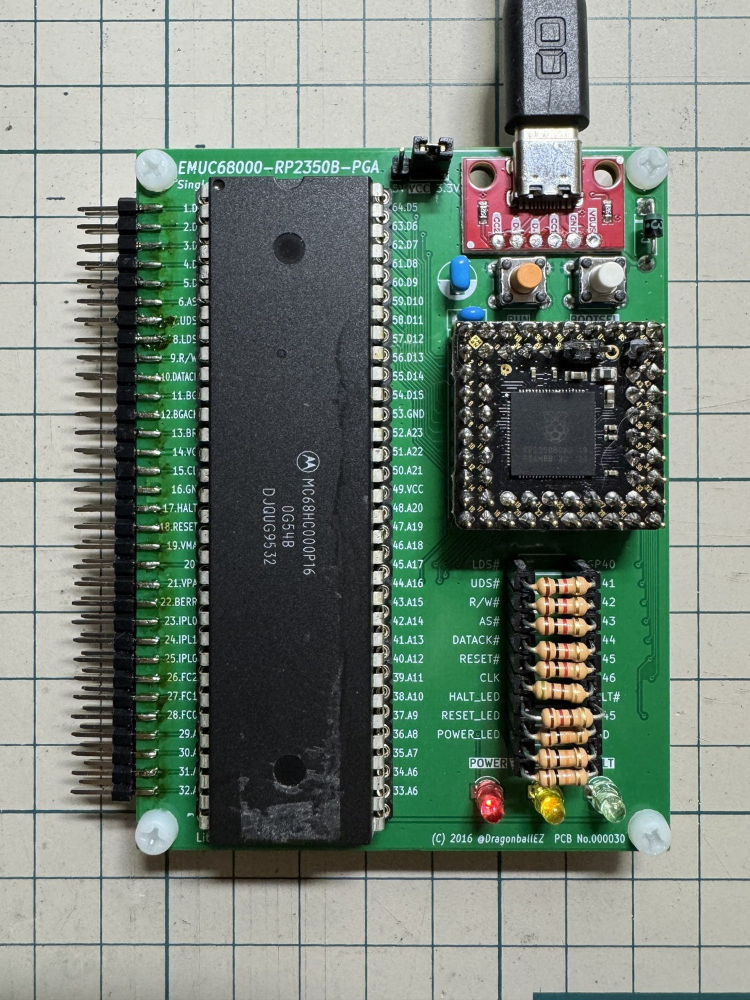
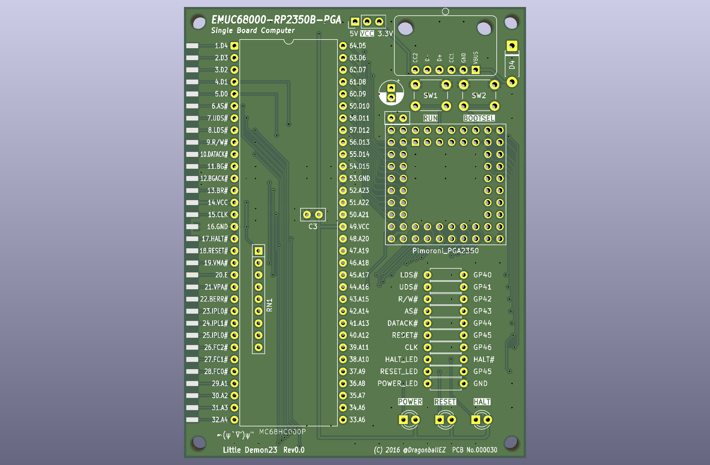
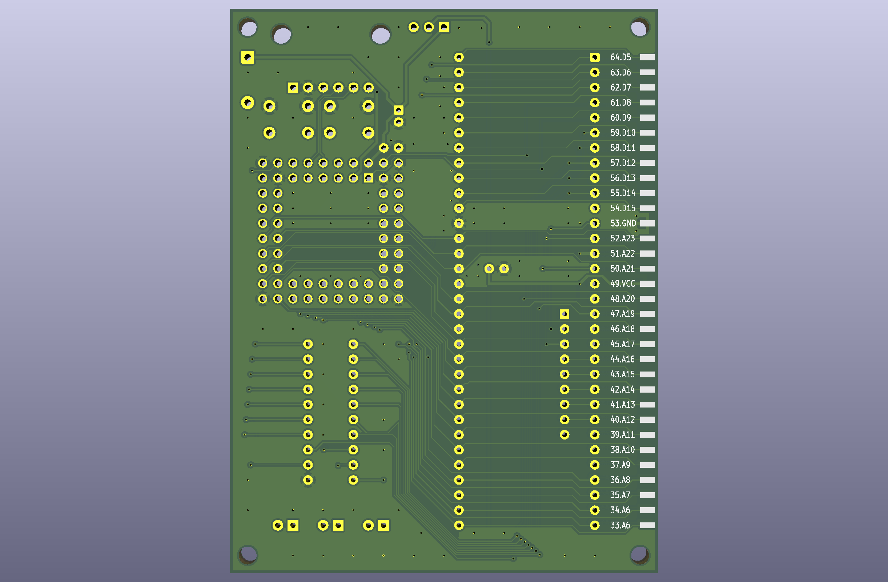
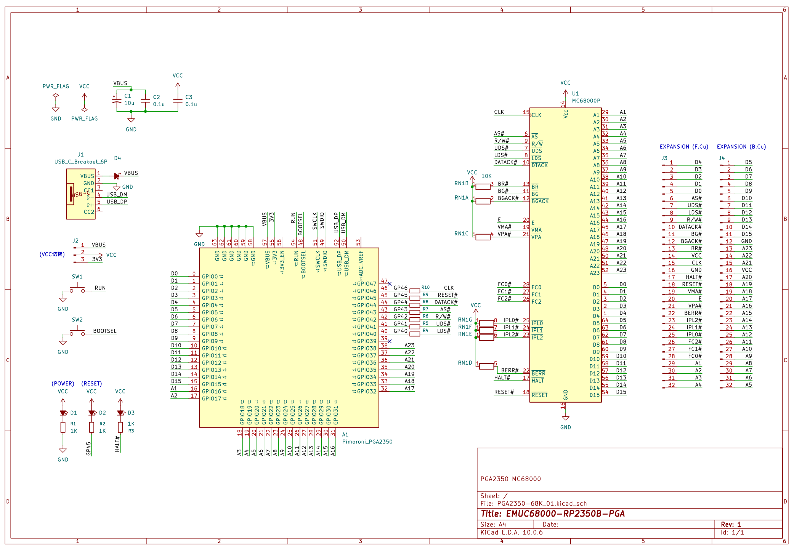
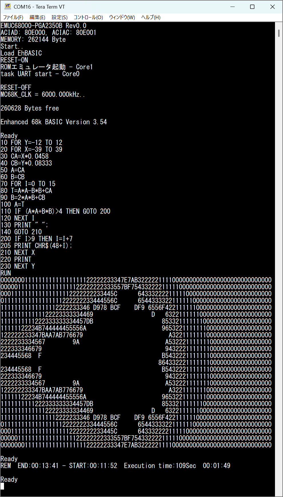

# EMUC68000-PGA2350B

MC68000 を Pimoroni PGA2350 で動作させるための暫定プロジェクトです。
動作確認や仕様が不十分な場合があります。

## 画像







## ビルド

Pico SDK と CMake、Ninja が利用できる環境で、リポジトリのルートから実行してください。

```sh
cmake -S . -B build -G Ninja -DCMAKE_BUILD_TYPE=Release
cmake --build build --parallel
```

## デュアルブート（MS-BASIC 68K）

起動直後にブートメニューが 3 秒間表示されます。`M` キーで
MS-BASIC 68K（Microsoft BASIC の MC68000 移植、拡張版）を、
それ以外またはタイムアウトで従来の EhBASIC を起動します。
移植の詳細は [msbasic68k/](./msbasic68k/) を参照してください
（原典 microsoft/BASIC-M6502 は MIT ライセンス）。

## 無保証

本プロジェクトは現状有姿で提供され、明示・黙示を問わず、動作、正確性、安全性、特定目的への適合性を保証しません。
本プロジェクトの利用・改変は利用者自身の責任で行ってください。

## ライセンス

本プロジェクト内の @DragonballEZ(kyo-t04) が作成した部分は、[MIT License](./LICENSE) の下で公開します。
EhBASIC 由来のプログラムデータや Raspberry Pi 由来のファイルなど、第三者の著作物はこのライセンスの対象外です。それぞれの権利者が定めるライセンス・利用条件に従ってください。
